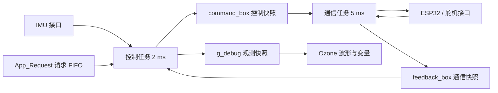

# STM32 主控框架说明

当前框架保留 FreeRTOS，应用层只有两个周期任务：**控制任务采集和计算，通信任务负责轮腿收发**。两个任务通过两个最新快照队列交换数据，调试器直接读取 `g_debug`，不增加调试任务。

构建速查见 [README.md](README.md)，硬件方案见 [for_agent.md](for_agent.md)，波形与运行诊断见 [OZONE.md](OZONE.md)。

## 1. 当前做到哪一步

已经实现启动、任务调度、静态数据交换、就绪检查、状态管理和调试数据发布，可以生成 ELF、HEX、BIN。

设备驱动和控制器仍为占位实现：设备读写返回 `DEVICE_NOT_READY`，测量无效，`Controller_Ready()` 返回 false。因此正常启动后保持待机，不会自动运动。当前没有 ESP32 固件、串口协议实现或自平衡算法。

## 2. 代码放在哪里

| 目录 | 职责 | 后续修改举例 |
|---|---|---|
| `Core` | 启动、时钟、CubeMX 初始化、板级配置、RTOS 和计时支持 | 修改硬件和系统配置 |
| `App` | 两个任务、状态机、保护检查、调试数据、设备接口和算法入口 | 编写机器人业务代码 |
| `vendor` | 固定 HAL、CMSIS、FreeRTOS 源码 | 整套升级匹配依赖 |

自己编写的业务代码集中在一个平铺目录：

```text
App/
  app.c / app.h             两个任务、应用接口、状态与调试数据类型
  app_logic.c / .h          状态机、保护检查、调试耗时统计
  devices.c / .h            IMU、轮部、腿部设备接口占位
  control.c / .h            算法入口
  robot_types.h            测量和目标的公共数据类型
```

保留一个 `app_logic.c`，是为了让状态、保护和统计逻辑脱离 HAL/RTOS，直接在电脑上测试。没有再为这些小功能分目录或单独建文件。

板级配置在 `Core/Inc/board_config.h`；RTOS 的静态内存钩子和 DWT 计时在 `Core/Src/rtos_support.c`；HAL 时基在 `Core/Src/hal_timebase.c`。

## 3. 上电如何启动

```text
复位 → 启动汇编 → SystemInit / C 运行环境 → main()
  → MPU、HAL、时钟、GPIO、SPI2、UART7、USART1 初始化
  → osKernelInitialize()
  → App_Init()
      启用 DWT 周期计数
      初始化设备接口和算法
      创建两个快照队列、一个请求队列
      创建 control / communication 任务
  → osKernelStart()
```

应用接入位于 `main.c` 的 USER CODE 区域。调度器启动后，工作由任务循环承担，后续业务不需要继续放进 `main()` 的空循环。

初始化函数在调度器启动前执行，不能依赖其他任务已开始运行。

## 4. 两个任务与数据流

| 任务 | 周期 | 优先级 | 执行顺序 |
|---|---|---|---|
| control | 2 ms | High | 采集 IMU → 读取通信快照 → 检查就绪 → 更新算法 → 消费请求并更新状态 → 发布目标 → 更新调试快照 |
| communication | 5 ms | Normal | 读取轮腿反馈 → 读取控制快照 → 检查输出条件 → 写轮腿目标 → 发布反馈及通信统计 |



没有独立的采集、状态管理、日志或调试任务。Idle 和 FreeRTOS 软件定时器任务仍由内核创建，所以 Ozone 任务列表中看到的任务总数会大于两个。

`command_box` 包含生成时间、运行许可和轮腿目标；`feedback_box` 包含轮腿测量、传输状态、故障、错误计数和通信任务耗时。它们都是静态单槽队列，通过 `xQueueOverwrite()` 原子复制最新完整结构，使用 `xQueuePeek()` 读取但不移除。

每个快照内部复制完整，但 IMU 与轮腿数据并非同步采样。这里没有历史采样缓存，也没有多传感器时间同步。

请求队列保留四槽 FIFO。`App_Request()` 的 true 只表示请求成功入队；控制任务每轮最多取出一个，再根据就绪条件决定是否转换状态。这不是硬件急停接口。

## 5. 数据和时间戳约定

类型定义在 `App/robot_types.h`：

| 数据 | 内容 | 单位 |
|---|---|---|
| ImuSample | 加速度、角速度 | m/s²、rad/s |
| Attitude | 横滚、俯仰、偏航 | rad |
| WheelFeedback | 两侧角度、速度、故障 | rad、rad/s |
| LegFeedback | 两侧位置、故障 | rad |
| WheelTarget | 两侧驱动电压、使能 | V |
| LegTarget | 两侧位置、速度、使能 | rad、rad/s |

数组下标与左右硬件、方向、零点的对应关系仍需在驱动接入时确认。内部结构不是 UART 协议，不能直接依赖结构体内存布局发送。

`SampleMeta` 包含 `valid` 和 `time_ms`。当前应用时间来自 1 kHz 的 `osKernelGetTickCount()`，因此 tick 值可作为毫秒使用；驱动应使用同一基准，不能混用起点不同的 `HAL_GetTick()`。

有效与新鲜必须同时满足。默认超时为 100 ms，使用无符号时间差，支持计数回绕。驱动返回缓存时必须保留采样原时间戳；没有可用结果应返回 NOT_READY。读接口返回非 OK 时，应用将对应测量标为无效。

## 6. 什么时候允许运行

状态仍为 INIT、STANDBY、RUNNING、FAULT：

- INIT 第一次更新进入 STANDBY；首次请求不用于使能。
- STANDBY 下条件齐备且收到 ENABLE，才能进入 RUNNING。
- RUNNING 下收到 DISABLE 回待机；反馈过期、算法失败或其他就绪条件丢失进入 FAULT。
- 明确的设备故障可使待机或运行状态进入 FAULT，优先于普通 DISABLE。
- FAULT 下条件恢复后需要 RESET 回待机，再发新的 ENABLE；不会自动恢复运动。

控制任务的就绪条件包括：IMU 与轮腿反馈有效且新鲜、通信快照新鲜、控制器就绪、算法更新成功，以及上轮轮腿写接口都返回 OK。

传输尚未就绪但测量和算法条件满足时，允许算法预热；输出仍被禁止。算法在待机也可能执行，因此后续添加积分器时，应显式设计运行状态输入或复位机制。

通信任务在写设备前再次检查运行许可、控制快照及目标时效、当前轮腿反馈、上轮传输状态和当前读故障；不通过就发送全零且禁用的目标。第一次启动也会先尝试禁用写入，以建立传输就绪状态。

**后续设备写接口必须先处理 `enable == false` 的禁用请求**，不能因其 `meta.valid == false` 而忽略。DEVICE_OK 的含义需由真实协议明确，目前不能等同于远端已执行。ESP32 仍需独立实现主控失联禁用。

## 7. Debug 如何工作

控制任务是 `g_debug` 的唯一写入者，每轮将 IMU、姿态、轮腿反馈、发布目标、状态和诊断复制进去。通信任务把自己的统计放入反馈队列，控制任务再统一发布。

调试结构不会被读回控制路径。在调试器中修改它不会形成控制命令，也不提供在线调参。

`not_ready_bits` 表示当前阻止运行的原因；`fault_bits` 记录本次进入 FAULT 时的原因，保留到成功 RESET。设备未就绪和测量无效不会伪造曲线：应先看有效标志，再解释数值。

DWT 周期计数用于统计任务业务段的耗时，包括被其他任务抢占的时间，排除主动等待。控制任务的快照发布、通信任务的队列发布发生在计时结束后；因此它是业务段诊断，不是完整 CPU 占用统计。单次测量应短于一次 32 位计数回绕（192 MHz 时约 22 秒）；暂停调试和单步期间的统计不用于性能判断。

超期计数表示业务段完成时已达到下一计划时刻，每轮最多加一。任务等待采用 `osDelayUntil()`；错过周期时重设基准并让出 CPU，不补跑全部历史周期。

## 8. 后续接入位置

1. **IMU**：在 `App/devices.c` 实现 BMI088 初始化和读取，核对 SPI2 片选、坐标、单位与时间戳。片选 GPIO 仍待确认。
2. **轮部**：实现 ESP32 协议的读写、校验和失联行为。USART1 当前 TX/RX 为 PB14/PB15，与硬件文档中的 PA9/PA10 待对齐。
3. **腿部**：实现 UART7 总线收发、ID、单位换算和机械限位。UART7 当前 TX/RX 为 PE8/PE7。
4. **算法**：在 `App/control.c` 实现 `Controller_Init/Ready/Update`。Ready 不能依赖首次 Update 才完成必要初始化；Update 成功需填写姿态及两类目标的有效标志、时间戳和使能。只填写轮部目标时，整组输出仍会被禁用。
5. **操作入口**：后续遥控或调试任务调用 `App_Request()`，中断不能直接使用该接口。

## 9. RTOS、构建和代码生成

任务控制块、两个 2 KB 应用任务栈、队列及内核对象均静态分配。栈大小是起点，加入算法后应检查实际栈水位。

SysTick 属于 FreeRTOS，TIM6 提供 HAL 毫秒时基，SVC/PendSV 属于内核移植层；不可重复定义。手工 RTOS 配置保存在 `Core/Inc/rtos_config.h`；`FreeRTOSConfig.h` 只是包含它的入口，CubeMX 再生成后由同步脚本恢复该入口。

```sh
cmake -S . -B build -G Ninja -DCMAKE_TOOLCHAIN_FILE=cmake/arm-gcc.cmake
cmake --build build
sh tests/run.sh
```

业务目录下的 `.c` 会自动纳入构建；增加子目录或依赖时修改 `cmake/firmware.cmake`。CubeMX 重新生成后运行 `python3 tools/sync_cube.py` 再构建。真实 CubeMX 再生成流程尚未在本机验证。

主机测试覆盖状态转换、时效检查、禁用输出和调试统计回绕；编译成功不代表任务时序或硬件通信已实测。推荐阅读顺序：main.c → App/app.c → app_logic.c → robot_types.h → devices.c / control.c。
