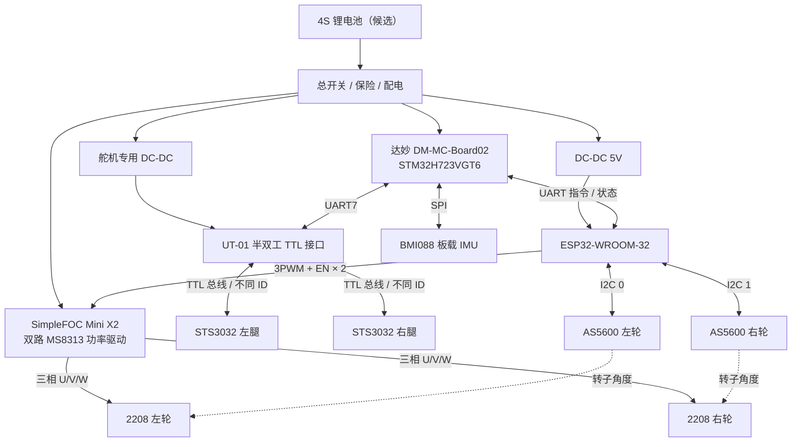

# 微型轮腿机器人硬件系统与通信架构

> 文档类型：开发文档 · 硬件与通信方案说明  
> 状态：设计方案，部分接口、电源参数及控制细节尚待实物核验。

## 1. 项目概述

本项目参考开源项目 **Micro-Wheeled_leg-Robot** 的机械结构和控制思路，设计一套基于 **STM32H7 + ESP32** 的微型双轮腿机器人控制系统。机器人采用双轮驱动与双侧舵机腿部调节相结合的结构，通过姿态测量、轮部电机闭环控制和腿部关节协同运动，目标实现自平衡、前后移动、原地转向、机身高度调节以及跳跃等功能。

硬件采用**双控制器协同架构**：达妙 **DM-MC-Board02** 作为机器人主控制器，负责姿态解算、平衡和整机运动控制；**ESP32-WROOM-32** 作为轮部电机控制器，负责双路 FOC。两级控制器通过 UART 进行数据交互。轮部使用 **2208-100T 三相无刷电机 ×2、AS5600 磁编码器 ×2、SimpleFOC Mini X2 双路三相驱动板 ×1**；腿部使用 **STS3032 串行总线舵机 ×2**，通过 UT-01 半双工 TTL 转接板接至主控。

方案优先使用现成开发板和驱动模块，减少定制 PCB 的数量，降低硬件成本和开发复杂度。

## 2. 系统架构

**说明**：图中电池与降压模块均为规划方案，具体输出电压、峰值电流和接口极性需要根据购买的实物规格确认；两侧 AS5600 的默认 I²C 地址相同，必须使用独立 I²C 总线或其他隔离方案。

## 3. 硬件组成及职责

### 3.1 主控制器：达妙 DM-MC-Board02

- **主芯片**：STM32H723VGT6。
- **板载 IMU**：BMI088，经 SPI 连接；不需要另购 MPU6050。
- **主要任务**：机器人状态管理、姿态估计、自平衡算法、转向与运动规划、腿部舵机控制、通信与安全管理。
- **通信接口**：使用一组 UART 与 ESP32 通信，使用另一组 UART 与 STS3032 总线转换板通信。
- **供电**：官方说明书标注 12～24V 输入；本方案考虑通过主电源接口接入合适电池，注意区分主电源输入和带 CAN 的可控电源输出接口。

### 3.2 轮部控制器：ESP32-WROOM-32

- 独立负责两个轮部电机的底层控制，运行 SimpleFOC 或兼容 FOC 控制程序。
- 从 STM32H7 接收左右轮目标控制量，执行本地闭环控制，并反馈轮部角度、速度及故障状态。
- 通过两组 I²C 接口分别读取 AS5600 角度传感器。
- 向双路功率驱动板输出六路 PWM（每台电机三路）及两路使能控制。
- 该架构初期采用**电压模式 FOC**，不将其表述为具备相电流传感器的精确电流/力矩闭环。

### 3.3 双路无刷电机驱动：SimpleFOC Mini X2

- **模块定位**：三相功率驱动板，不带独立主控，不会自行执行 FOC 算法。
- **板载驱动**：商品资料标称 MS8313 ×2。
- **输入**：每路 IN1～IN3、EN；双路合计六路 PWM 与两路 EN。
- **输出**：左右电机各三根 U/V/W 相线。
- **供电**：商品宣传输入范围 8～35V、每路峰值/最高标称电流 2.5A，连续能力及散热须实测/核查产品资料。
- **控制注意事项**：驱动板可承受某电源电压，不代表 2208 电机可直接承受同等幅值的三相输出；必须通过固件设置安全的电压与运行限制。

### 3.4 轮部电机与编码器

- **轮部电机**：2208-100T 三相无刷电机 ×2。
- **编码器**：各自配套 AS5600 磁编码器 ×1，采用 I²C 通信。
- **反馈用途**：获取转子机械角度，估计转速，为 FOC 换相和轮部反馈控制提供数据。
- **关键要求**：检查编码器磁铁安装方向和同轴度；实际电机极对数需要核实，不能仅照抄开源项目中的配置。
- **地址问题**：两个 AS5600 一般使用相同默认地址 `0x36`，应分别连接两组 I²C 控制器/独立总线。

### 3.5 腿部系统：STS3032 ×2 与 UT-01

- 左右腿分别配置一台飞特 STS3032 舵机。
- STS3032 内部已有电机驱动及位置控制，无需再外加三相功率驱动板。
- 两台舵机共用一条单线半双工 TTL 通信总线，以不同舵机 ID 寻址。
- 达妙 H7 通过 UART 与 **UT-01（3.3V UART 逻辑兼容版本，待核实）**连接；UT-01 再连接两台 STS3032。
- 舵机使用独立电源支路，通信逻辑供电与舵机动力电源须区分。
- 运动目标包括腿部位置协调、机身高度调节及跳跃动作；具体速度、加速度和机械限位需在测试中确定。

### 3.6 电源系统

采用**单电池集中配电、多路稳压**架构，规划为：

1. 一块 **4S 锂电池（标称 14.8V、满电 16.8V）**经 XT 接头接总开关、保险与配电模块。
2. 配电一路接 DM-MC-Board02 的**主电源输入**。
3. 配电一路接双路 SimpleFOC 功率驱动板的电机功率输入。
4. 配电一路经 **5V DC-DC** 给 ESP32 开发板 5V/VIN 供电；ESP32 的稳压 3.3V 支路为适配的编码器供电。
5. 配电一路经**舵机专用 DC-DC** 给 UT-01 舵机电源端和两只 STS3032 供电；其输出电压与电流能力须按 STS3032 实际规格核对。

**供电安全要求**：电池 XT 插头类型不等于电压类型。电机和舵机的动力电流不能经过杜邦线或 MCU 信号地回流。应配置合适线径、配电保护、共地、欠压停机和接插件防反接措施。DM-02 说明书的 12～24V 输入范围不是“必须恒定输入 12V”，但 4S 低电量时必须防止低于允许输入范围。两侧 STS3032 不得直接连接未降压的 4S 电池。

## 4. 通信接口汇总

| 通信双方 | 物理接口/协议 | 功能 | 备注 |
|---|---|---|---|
| DM-02 ↔ ESP32 | 3.3V UART（TX、RX、GND） | 下发左右轮控制目标、读取运行状态 | 具体数据帧与超时策略待定义 |
| DM-02 ↔ BMI088 | SPI | 姿态相关的惯性测量数据 | BMI088 已板载 |
| DM-02 ↔ UT-01 | 3.3V UART（TX、RX、GND） | 舵机控制指令与状态返回 | 需核实 UT-01 MCU 侧电源脚定义 |
| UT-01 ↔ STS3032 ×2 | 单线半双工 TTL | 通过 ID 控制左右腿 | 两只舵机使用独立 ID |
| ESP32 ↔ AS5600 左轮 | I²C 总线 0 | 转子角度反馈 | 地址通常 0x36 |
| ESP32 ↔ AS5600 右轮 | I²C 总线 1 | 转子角度反馈 | 与左轮分开 |
| ESP32 → SimpleFOC Mini X2 | 6×PWM + 2×EN | 双路 FOC PWM 控制 | 每路电机 3PWM + EN |
| SimpleFOC Mini X2 → 2208 ×2 | 三相 U/V/W 功率输出 | 驱动左右电机 | 不能用普通杜邦线承载动力电流 |

### 4.1 暂定接口映射

> 以下映射是开发阶段的候选方案，需在实物接线、ESP32 GPIO 能力与 SimpleFOC 固件中核对后固定。

**DM-02 ↔ ESP32**

| DM-02 | ESP32 | 用途 |
|---|---|---|
| USART1_TX（PA9） | GPIO19（RX） | H7 → ESP32 |
| USART1_RX（PA10） | GPIO18（TX） | ESP32 → H7 |
| GND | GND | 共同信号参考地 |

**DM-02 ↔ UT-01**

| DM-02 | UT-01 | 用途 |
|---|---|---|
| UART7_TX（PE8） | RX | H7 发送舵机指令 |
| UART7_RX（PE7） | TX | 接收舵机应答 |
| GND | GND | 共地 |
| 逻辑电源（待确认） | UT-01 VCC | 根据转接板规格确定是 3.3V 还是 5V |

**ESP32 ↔ SimpleFOC Mini X2**

| ESP32 | 驱动板 | 功能 |
|---|---|---|
| GPIO25 / GPIO26 / GPIO27 | IN1 / IN2 / IN3 | 左电机三路 PWM |
| GPIO14 | EN1 | 左电机使能 |
| GPIO32 / GPIO33 / GPIO23 | IN4 / IN5 / IN6 | 右电机三路 PWM |
| GPIO13 | EN2 | 右电机使能 |
| GND | GND | 共同信号参考地 |

**ESP32 ↔ 两个 AS5600**

| 编码器 | VCC | GND | SDA | SCL |
|---|---|---|---|---|
| 左轮 AS5600 | 3.3V | GND | GPIO21 | GPIO22 |
| 右轮 AS5600 | 3.3V | GND | GPIO16 | GPIO17 |

必须验证实际 AS5600 模块支持 3.3V 供电、两路 I²C 可在所用 ESP32 固件环境下正常并行使用，且总线有合适的上拉电阻。

## 5. 控制数据流

### 5.1 机身平衡控制

1. DM-02 周期性采集板载 BMI088 的加速度及角速度。
2. 运行姿态估计、平衡及转向控制算法。
3. 结合 ESP32 反馈的轮角度与轮速，计算左右轮目标控制量。
4. 通过 UART 将目标指令发送给 ESP32。
5. ESP32 读取编码器，执行左右电机 FOC，并控制双路 MS8313 功率驱动。
6. ESP32 周期性返回轮部状态和故障信息，形成机器人闭环控制链路。

### 5.2 腿部控制

1. DM-02 根据动作模式及机器人姿态计算左右腿舵机目标。
2. 通过 UART7 将指令发往 UT-01。
3. UT-01 将标准 UART 转换为 STS3032 的单线半双工总线信号。
4. 两只 STS3032 按各自 ID 接收并执行目标位置等指令。
5. 必要时读取舵机状态，用于协调动作和故障处理。

### 5.3 安全控制

- 主控与 ESP32 通信超时：轮部输出进入安全状态（禁止保持失联前运动命令）。
- 电机驱动上电初始化时默认关闭 EN，完成传感器和控制参数初始化后再使能。
- 对轮部目标电压/速度、腿部目标位置/速度进行限制。
- 增加电池低压、驱动过热/故障（以硬件支持为准）、舵机异常与机身严重倾倒等异常处理。
- 调试阶段先使用限流电源、空载测试，再上机负载测试；跳跃功能最后验证。

## 6. 设计特点与当前待验证项

### 6.1 设计特点

- **分层控制**：STM32H7 侧负责整机运动，ESP32 侧负责高频双轮 FOC。
- **模块化**：电机功率驱动、编码器、腿部总线和供电模块相互独立。
- **低成本优先**：采用现成 SimpleFOC Mini X2、ESP32 开发板和 UT-01，而非自行设计 CAN FOC PCB。
- **传感器复用**：利用 DM-02 板载 BMI088，以及电机随附的两只 AS5600。

### 6.2 待核实和测试的关键项目

- [ ] 已购买电池的串数、XT 接口类型、电池容量与放电倍率。
- [ ] 2208-100T 电机的极对数、绕组参数、额定/限制电流与安全驱动电压。
- [ ] MS8313 双路驱动板的真实引脚顺序、连续输出能力、故障保护及散热条件。
- [ ] STS3032 的额定工作电压与堵转电流；确定专用 DC-DC 的输出规格。
- [ ] UT-01 3.3V 版本的 UART 逻辑电平与 VCC 接口供电要求。
- [ ] 两路 AS5600 的 I²C 线路、磁铁装配、角度读取精度与总线刷新率。
- [ ] ESP32 六路 PWM 与双路 I²C 的硬件/软件资源分配及 FOC 控制周期。
- [ ] STM32H7 ↔ ESP32 的 UART 帧结构、控制量单位、发送频率、状态反馈与超时停车策略。
- [ ] 整机质量和轮腿机构设计是否支持安全跳跃。

---

*本文描述当前计划采用的硬件系统和通信组成。尚未完成实物验证的参数均按候选设计处理，不应直接当作已经测试通过的接线或供电规格。*
